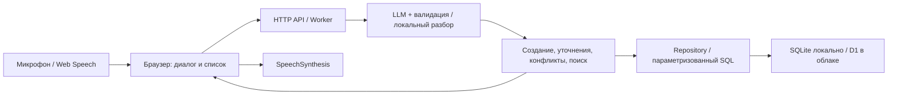

# Рядом

Голосовой помощник для личных задач, напоминаний и встреч. Русский диалог, долговременное хранение, поиск по 1 000 записям из приложенного CSV.

**Размещение вне ChatGPT:** подготовлен [деплой из GitHub в Railway](docs/DEPLOYMENT.md) с постоянным диском для SQLite и HTTPS. Он не требует Sites или домена `chatgpt.site`. Для фактической публикации нужны авторизованные аккаунты GitHub и Railway; новая внешняя ссылка пока не получена.

**Исходники:** текущий Git-репозиторий. История разделена по этапам: база и данные → логика ассистента → интерфейс → исправления и тесты → документация и поставка. Репозиторий Sites синхронизируется при публикации; отдельный GitHub-репозиторий не создавался без подключённого GitHub.

GitHub Pages размещает статические файлы и не запускает сервер этого приложения. На GitHub размещаются исходники и CI, а Docker-сервис с базой запускается на отдельном хостинге.

## Быстрый запуск

Требуется **Node.js 22.13+**, npm. Проверено на Node 22.14. В Node 22 встроенный `node:sqlite` выводит предупреждение ExperimentalWarning — это не ошибка запуска.

```bash
npm ci
npm start
```

Открыть **http://localhost:3000**. Никаких ключей для основных сценариев не требуется. При первом открытии приложение импортирует исходные 1 000 записей. База создаётся в `.local/ryadom.sqlite`, миграции применяются автоматически. Остановка и повторный запуск сохраняют записи, историю диалога и незавершённое уточнение.

```bash
# Проверки и сборка
npm test
npm run build

# Изменить настройки запуска
cp .env.example .env
# Отредактировать .env, затем повторить npm start
```

`HOST` по умолчанию `127.0.0.1`, `PORT` — `3000`, `DATABASE_PATH` — `.local/ryadom.sqlite`. Для локального HTTPS или прокси используйте выбранный вами reverse proxy. Голосовой ввод разрешён браузером на HTTPS или localhost.

### Docker

```bash
docker compose up --build -d
docker compose logs -f
docker compose down
```

Адрес Docker-версии: **http://localhost:3001**. Внешний порт настраивается переменной `RYADOM_HTTP_PORT` в `.env` или при запуске:

```bash
RYADOM_HTTP_PORT=3100 docker compose up -d
```

В этом примере адрес будет http://localhost:3100. Внутри контейнера приложение всегда слушает порт 3000; `PORT` в `.env` относится к запуску через `npm start`. Если внешний порт уже занят другим приложением, выберите свободный `RYADOM_HTTP_PORT`.

Именованный том `ryadom-data` сохраняет SQLite между пересозданиями контейнера. `docker compose down` оставляет том. Порт опубликован только на loopback. Runtime-образ работает от непривилегированного пользователя, без npm-зависимостей: серверный код заранее собран в один ESM-модуль. Запуск контейнера на порту 3001 и ответ `/health` проверены.

## Попробовать за две минуты

1. «Напомни мне завтра в 10 утра позвонить Ивану» — появится напоминание с датой и временем.
2. «Поставь встречу с Иваном завтра» — ассистент уточнит время. «В 11:30» завершит создание.
3. «Что запланировано на эту неделю?» или «Какие задачи у меня на завтра?» — список за нужный период.
4. «Найди задачу про презентацию», «Когда у меня была встреча с Иваном?» или «Найди задачу по контракту» — поиск в том числе по архиву, с учётом словоформ и словаря близких понятий.
5. После создания: «А перенеси её на послезавтра», затем «Отметь её выполненной».
6. «Удали её» — удаление произойдёт только после «Да». «Отмена» отменяет текущее действие.

Для неоднозначного изменения ассистент предлагает выбрать карточку. В каждой карточке есть кнопки выполнения, переноса и удаления. Пересечение встреч требует отдельного подтверждения. По умолчанию встреча длится 60 минут; можно сказать «на 90 минут». Проверяются также встречи, переходящие через полночь.

Вся история доступна слева; поиск справа ищет по всем датам. Сегодня может быть пусто: даты CSV не сдвигались для демонстрации. Задачи без даты видны в разделе «Задачи». Завершённые записи остаются в истории и поиске.

## Голос

Кнопка микрофона запускает Web Speech API с языком `ru-RU`. После окончания фразы распознанный текст автоматически отправляется ассистенту. Предусмотрены состояния записи и ошибки доступа к микрофону, сети и отсутствия речи. Наиболее подходящие браузеры — Chrome и Edge. Если распознавание не поддерживается, доступен текстовый ввод.

Флажок «Озвучивать ответы» включает `SpeechSynthesis`; выбор русской озвучки зависит от установленных голосов. Само приложение не сохраняет аудио. Браузер может передавать речь своему сервису распознавания — это поведение Web Speech API.

Напоминания проверяются каждые 30 секунд **пока вкладка открыта**. По кнопке колокольчика можно разрешить системные уведомления. Без разрешения показывается уведомление внутри приложения. При возвращении во вкладку проверяются пропущенные напоминания за последние сутки. Доставка в закрытом браузере и точное фоновое срабатывание не реализованы.

## Подключение ИИ

У приложения два явно обозначенных режима:

- **Локальный режим:** Chrono для русских дат, выделение намерения правилами, Snowball для словоформ, словарь понятий и нечёткое ранжирование поиска. Это не нейросетевая модель; поддержка произвольных формулировок ограничена. Все четыре обязательных действия работают без внешнего сервиса.
- **LLM:** OpenAI-совместимый `/chat/completions`. Модель переводит произвольную фразу в строго валидируемое действие. Она не получает доступа к SQL или операциям записи. Для распознанной локально даты используется её результат вместо возможной выдумки модели. При таймауте, ошибке провайдера или невалидном JSON запрос обрабатывается локально; интерфейс сообщает о переключении.

Пример `.env` для облачного провайдера:

```dotenv
LLM_BASE_URL=https://api.openai.com/v1
LLM_API_KEY=your-key
LLM_MODEL=your-available-model
LLM_SEARCH=false
```

Для локального Ollama:

```bash
ollama pull qwen3:8b
```

```dotenv
LLM_BASE_URL=http://localhost:11434/v1
LLM_MODEL=qwen3:8b
LLM_API_KEY=
LLM_SEARCH=false
```

Провайдер должен поддерживать JSON object response format. Выбор и загрузка модели, квоты и ключ находятся на стороне провайдера. API-ключ не передаётся браузеру и не коммитится. В опубликованной версии ключ LLM не настроен, используется локальный режим. Реальный вызов платной/локальной модели в окружении сборки не проверялся; контракт интеграции и обработка ошибок покрыты тестовыми ответами провайдера.

`LLM_SEARCH=true` включает дополнительное смысловое ранжирование моделью: отправляются текст запроса и до 60 названий кандидатов. При выключенной настройке для интерпретации отправляются только текущий текст, локальное время и незавершённый черновик диалога. Полный CSV модели не отправляется. Нейросетевые embeddings не используются.

## Архитектура



| Часть | Файл | Ответственность |
| --- | --- | --- |
| HTTP и границы | `src/worker.js` | Маршруты, валидация входа, cookie, защита источника, статика |
| Ассистент | `src/assistant.js` | Бизнес-действия, уточнения, подтверждения и транзакционный план |
| NLP / даты | `src/nlp.js`, `src/dates.js` | Намерения, календарные даты и периоды |
| ИИ-провайдер | `src/llm.js` | JSON-контракт, таймаут, валидация и fallback |
| Поиск | `src/search.js` | Стемминг, доменные синонимы, опечатки и ранжирование |
| Хранилище | `src/repository.js` | SQL, импорт и атомарное сохранение диалога вместе с действием |
| Локальный сервер | `scripts/server.mjs`, `scripts/sqlite.mjs` | Node HTTP и адаптер встроенного SQLite |
| Модель данных | `db/schema.ts`, `drizzle/` | Версионируемые миграции Drizzle |
| Интерфейс | `public/` | Адаптивный интерфейс без UI-фреймворка, голос, напоминания |

Одна серверная реализация работает и как Cloudflare Worker, и в Node. Esbuild включает зависимости, статику и исходный набор в переносимый модуль. В локальном запуске D1-интерфейс имитирует небольшой адаптер поверх встроенного `node:sqlite`. Для маленького прототипа это сокращает число инфраструктурных сервисов и расхождения между окружениями.

Схема событий: тип, название, дата, время, длительность, статус, дата создания и изменения, исходный ID CSV. Дата и время хранятся как локальные календарные значения, интерфейс использует `Europe/Minsk`. HTTP-интерпретация поддерживает IANA timezone; для изменения часового пояса всего продукта потребуется также менять правила напоминаний. Периоды полуоткрытые: `start <= date < end`. Неделя начинается в понедельник.

Запись события, обновление контекста и журнал ответа идут одной транзакцией. `requestId` предотвращает дублирование при сетевом повторе. Уникальная ревизия диалога предотвращает потерю контекста при конкурентных запросах: второй получает 409 и может повторить запрос. Это защита диалога; проверка конфликтов расписания между разными одновременными диалогами не является глобальной блокировкой.

Подробнее: [API](docs/API.md), [решения и ограничения](docs/DECISIONS.md), [проверка требований](docs/VERIFICATION.md).

## Данные и приватность

`data/events.csv` — неизменённый файл пользователя. `data/events.json` получается командой `npm run data:convert` (Python 3 нужен только для повторной конвертации). BOM обработан; даты, время, текст и 1 000 исходных ID сохранены. Типа записи в CSV нет: встречи определяются по началу текста «Встреча / Созвон / Демо…», напоминания — «Напом…», остальное считается задачами. Это эвристика, а не новая разметка исходного файла.

Для каждого браузера создаётся отдельное пространство с собственной копией данных. Непредсказуемый идентификатор хранится в `HttpOnly`, `SameSite=Lax` cookie (`Secure` на HTTPS); SQL всегда ограничен пространством. Идентификатор cookie не возвращается в событиях. LocalStorage хранит ID диалога, настройки озвучки и отметки показанных уведомлений. Очистка cookie начинает новое пространство; для восстановления текущего используйте экспорт и резервную копию базы. Полноценного аккаунта и синхронизации между устройствами нет.

Кнопка экспорта выгружает все ваши события в JSON. Источник CSV импортируется идемпотентно, повторное открытие страницы не создаёт дубликаты. Миграции выполняются при локальном запуске и при облачном деплое, а не в обработчике пользовательского запроса. Входной текст выводится через `textContent`, без интерпретации HTML.

## Что улучшить дальше

Нейросетевой векторный поиск с оценкой качества на размеченных парафразах; отдельные STT/TTS для единообразной работы браузеров; фоновые уведомления через очередь; авторизация и синхронизация устройств; календарная интеграция; повторяющиеся события; хранение временных зон на уровне события и отдельная политика DST; ограничения частоты и количества записей; удаление старых пространств; глобальная координация конкурентных изменений расписания.
